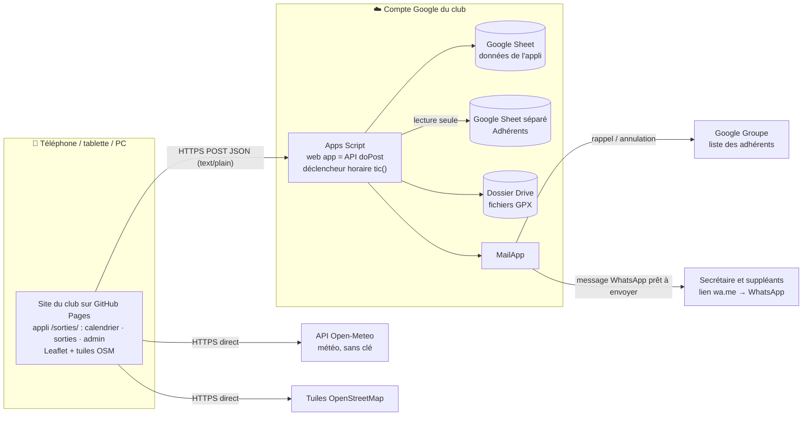
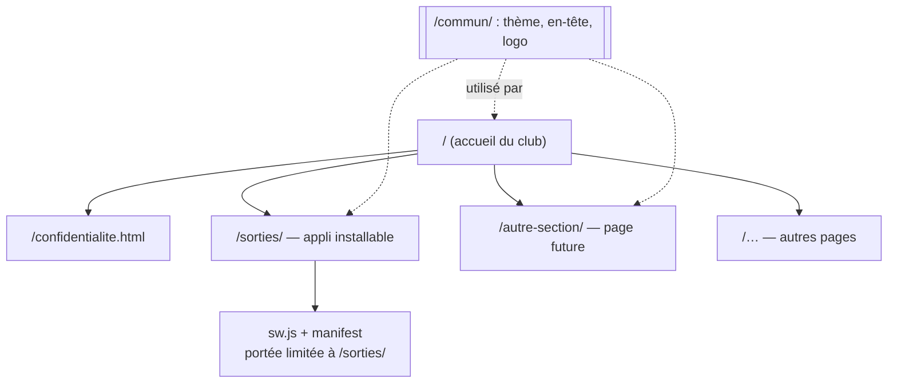
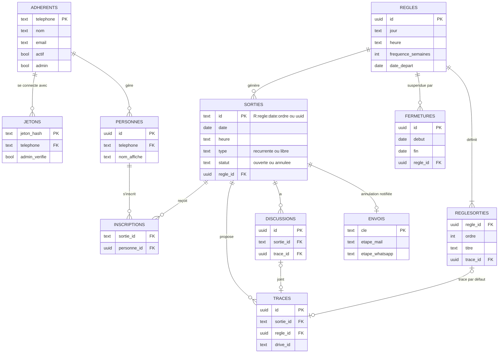
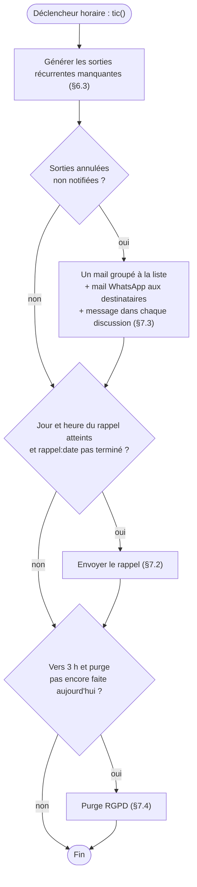
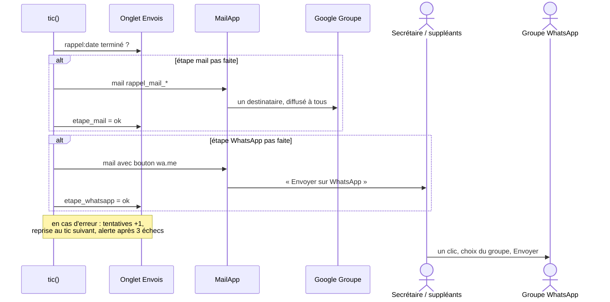
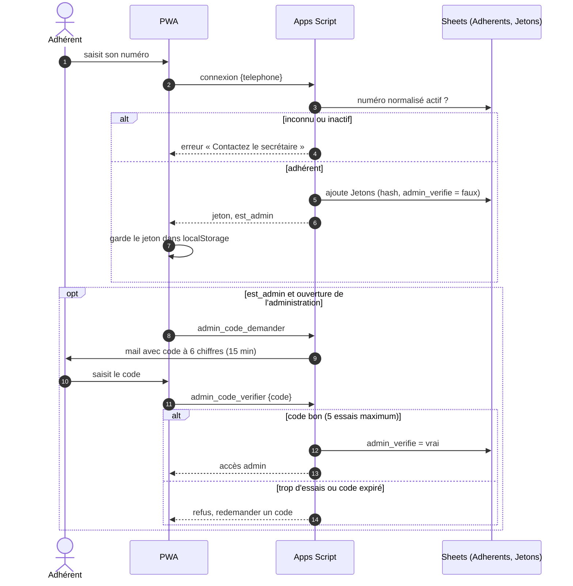

# Appli de sorties du club de VTT : spécifications techniques

*Version 0.2 du 12/11/2026. À lire avec les spécifications fonctionnelles v0.2.*

Les mentions **[décidé]** signalent ce que l'association a validé. Les mentions **[choix du rédacteur]** sont des propositions argumentées, que le développeur peut remettre en cause.

---

## 1. Contraintes structurantes

| Contrainte | Conséquence |
|---|---|
| Coût nul, sans carte bancaire **[décidé]** | Le compte Google du club, un hébergement statique gratuit et des API publiques gratuites. Ni Firebase payant, ni API WhatsApp Business. |
| Appli installable **[décidé]** | Une PWA (application web installable) servie depuis un hébergement statique. Une web app Apps Script ne peut pas être une PWA : elle s'affiche dans une iframe et ne fournit pas de manifeste. |
| WhatsApp en « un clic par semaine » **[décidé]** | Pas de bot. Un mail envoyé au secrétaire et aux suppléants contient un lien `https://wa.me/?text=…`. |
| Identification par téléphone, sans SMS, vérifiée contre la liste des adhérents **[décidé]** | Un jeton de session est émis à la connexion. |
| Maintenance par des bénévoles **[choix du rédacteur]** | HTML, CSS et JavaScript « vanille », sans étape de build. Les seules bibliothèques externes sont Leaflet (cartes), chargée depuis un CDN, et le code de §5. |

## 2. Architecture



- **Front** : GitHub Pages **[choix du rédacteur]**. Netlify et Cloudflare Pages conviennent aussi. Il faut créer un compte GitHub gratuit au nom du club.
- **Back** : Apps Script lié au Sheet, déployé en *web app* avec « Exécuter en tant que : moi » et « Accès : tout le monde ».
- **Fuseau horaire** du script et du Sheet : `Europe/Paris`.

### 2.1 Organisation du site statique (plusieurs pages) **[décidé]**
L'hébergement GitHub Pages porte **le site du club tout entier**, et pas seulement l'appli des sorties. L'appli n'est qu'**une section** du site, dans son propre dossier. D'autres pages, sans lien avec les sorties, peuvent s'ajouter sans toucher à l'appli.

**Adresse** : un compte GitHub d'organisation au nom du club (par exemple `vttclub`) et un dépôt nommé `vttclub.github.io`. Le site est alors servi à la racine : `https://vttclub.github.io/`, et l'appli à `https://vttclub.github.io/sorties/`. Un nom de domaine du club pourra s'y brancher plus tard sans rien changer à l'organisation.

**Arborescence** du dossier publié `site/` :

```text
site/
├── index.html               accueil du club : présentation, liens vers les sections
├── confidentialite.html     page RGPD commune à tout le site
├── 404.html                 page « introuvable »
├── commun/                  partagé par toutes les pages
│   ├── theme.css            couleurs, polices, en-tête, pied de page
│   ├── entete.js            insère l'en-tête et le menu à partir d'une seule liste de pages
│   └── images/              logo, favicon
├── sorties/                 L'APPLI (PWA)
│   ├── index.html
│   ├── app.js  api.js  meteo.js  gpx.js  admin.js  config.js
│   ├── style.css            styles propres à l'appli, en plus de commun/theme.css
│   ├── manifest.webmanifest scope et start_url = /sorties/
│   ├── sw.js                service worker, limité à /sorties/
│   └── icones/              192 et 512 px
└── <autre-section>/         toute nouvelle page : un dossier + un index.html
    └── index.html
```



**Règles :**
- **Une section = un dossier avec un `index.html`.** Les adresses restent propres (`/sorties/`, `/agenda/`…).
- **Le menu est défini à un seul endroit** : la liste des pages dans `commun/entete.js`. Ajouter une page = créer son dossier et ajouter une ligne à cette liste **[choix du rédacteur]**.
- **Le service worker et le manifeste restent dans `/sorties/`.** Leur portée est donc limitée à l'appli : l'appli installée n'ouvre que les sorties, et les autres pages restent de simples pages web, jamais mises en cache par l'appli. **Aucun service worker à la racine.**
- **Chemins relatifs** dans chaque page (`../commun/theme.css`), pour que le site fonctionne aussi si le dépôt est publié sous un sous-chemin ou derrière un nom de domaine.
- Le service worker de l'appli met aussi en cache les fichiers de `commun/` qu'elle utilise, pour fonctionner hors ligne.
- Les pages hors appli sont **purement statiques** : aucune collecte de données. Seule l'appli appelle l'API.
- `url_appli` (paramètre) vaut `https://vttclub.github.io/sorties/` : c'est ce lien qui figure dans les messages.

## 3. Modèle de données (onglets du Google Sheet)

Le code lit les colonnes **par leur en-tête**, jamais par leur position. Toutes les dates sont au format `AAAA-MM-JJ` et les heures au format `HH:MM`, stockées **en texte** pour éviter les conversions automatiques de Sheets. Les identifiants sont des UUID, sauf mention contraire.



Le schéma ne montre que les clés et les champs utiles aux liens ; le détail des colonnes suit. `Parametres`, `Modeles` et `Journal` sont des onglets autonomes sans lien.

### Tenus par le secrétaire, dans un fichier séparé **[choix du rédacteur]**
**`Adherents`** se trouve dans un **Google Sheet distinct** (« Adhérents du club »), lu par le script avec `SpreadsheetApp.openById` (identifiant dans les propriétés du script). Colonnes : nom, telephone, email, actif (case à cocher), **admin** (case à cocher).

Pourquoi un fichier séparé : le secrétaire n'a pas besoin d'accéder aux données de l'appli, et une mauvaise manipulation de sa part ne peut pas casser les onglets gérés par le code. Le chargement initial consiste à copier la liste existante du secrétaire dans ce fichier. L'email est **obligatoire pour les administrateurs** (voir §8, double vérification), facultatif pour les autres.

### Gérés via la page d'administration (le Sheet n'est que le stockage)
- **`Regles`** : id, nom, jour (lundi à dimanche), heure, point_rdv, frequence_semaines (1, 2…), date_depart, active.
- **`RegleSorties`** : regle_id, ordre (1, 2, 3…), titre, lieu, km, dplus, description, trace_id (facultatif).
- **`Fermetures`** : id, debut, fin, regle_id (vide si toutes les règles sont concernées), motif, cree_par.
- **`Parametres`** (clé / valeur) :
  - commune_nom, commune_lat, commune_lon ;
  - point_rdv_defaut ;
  - rappel_jour, rappel_heure ;
  - adresse_liste (adresse @googlegroups.com) ;
  - destinataires_whatsapp, email_alertes ;
  - whatsapp_numero (facultatif) : s'il est renseigné, le lien devient `https://wa.me/<numero>?text=…` et ouvre directement la conversation avec ce numéro. Vide, le lien laisse choisir la conversation ou le groupe ;
  - conservation_mois, url_appli, contact_rgpd.
- **`Modeles`** (clé / valeur) :
  - rappel_mail_objet, rappel_mail_corps, rappel_whatsapp ;
  - annulation_mail_objet, annulation_mail_corps, annulation_whatsapp.
  - Le rappel hebdomadaire est un **simple rappel avec le lien de l'appli** **[décidé]**. Il n'utilise que `{{lien}}`. Les modèles par défaut, rappel comme annulation, invitent d'abord à ouvrir l'appli installée depuis l'écran d'accueil, puis donnent `{{lien}}` pour la version web (texte en spécification fonctionnelle §4.9).
  - Les modèles d'annulation utilisent `{{lien}}` et `{{liste_annulations}}`. Ce second champ est un bloc texte que le code génère, avec une ligne par sortie annulée : titre, date, heure, motif. Il n'y a donc pas besoin de boucle dans le moteur de modèles, et le même modèle sert pour une ou plusieurs annulations.

### Gérés par le code
- **`Jetons`** : jeton_hash, telephone, appareil (libellé indicatif), admin_verifie, code_hash, code_expire, code_essais, cree_le, derniere_utilisation. Il y a **une ligne par jeton** : un même numéro peut être connecté sur plusieurs appareils (téléphone, tablette, Safari et appli installée).
- **`Personnes`** : id, telephone, nom_affiche, actif.
- **`Sorties`** : id, date, heure, titre, point_rdv, lieu, km, dplus, description, type (`recurrente` ou `libre`), regle_id, ordre, createur_tel, createur_nom, statut (`ouverte` ou `annulee`), motif_annulation, a_notifier (annulation à annoncer par mail et WhatsApp), annulation_notifiee, modifie_par, modifie_le, cree_le.
  - L'id d'une sortie récurrente est **déterministe** : `R:<regle_id>:<date>:<ordre>`. Cela garantit l'unicité et empêche de régénérer une sortie annulée.
- **`Inscriptions`** : sortie_id, personne_id, nom_affiche, telephone, horodatage.
- **`Discussions`** : id, sortie_id, auteur_nom, telephone, texte, trace_id, horodatage, supprime.
- **`Traces`** : id, sortie_id (vide pour une trace par défaut de règle), regle_id (renseigné pour une trace par défaut), nom_fichier, drive_id, km, dplus, ajoute_par_tel, ajoute_par_nom, horodatage.
  - Une sortie générée ne **copie pas** la trace par défaut de sa règle : elle y fait référence par `RegleSorties.trace_id`.
  - Une trace de règle n'est supprimable que depuis l'administration. La purge ne la touche pas tant que la règle existe.
  - Sur une sortie, `trace_supprimer` appliqué à la trace par défaut la masque pour cette sortie uniquement (colonne `traces_masquees` de `Sorties`).
- **`Envois`** : cle (par exemple `rappel:2026-11-12` ou `annulation:<sortie_id>`), etape_mail, etape_whatsapp, tentatives, derniere_erreur.
- **`Journal`** : horodatage, type, detail.

**Les numéros de téléphone ne sortent jamais de l'API**, à l'exception de celui du compte connecté. Pour indiquer qui a créé ou modifié quelque chose, l'API ne renvoie que des noms.

## 4. API (Apps Script `doPost`)

- **Format d'appel** : une seule URL, en `POST`, avec un corps `text/plain` contenant du JSON. Cette requête « simple » évite le préflight CORS, qu'Apps Script ne sait pas gérer.
  - Requête : `{action, jeton, ...}`.
  - Réponse : `{ok, data}` ou `{ok:false, erreur, message}`.
- **Verrou** : toutes les écritures prennent `LockService.getScriptLock()` (attente maximale de 10 s) et restent courtes. Une écriture ajoute ou supprime des lignes ciblées ; elle ne réécrit jamais un onglet entier.
- **Cache** : l'objet « calendrier » (14 jours) est mis en cache dans `CacheService` et invalidé à chaque écriture. Comme `CacheService` limite chaque clé à 100 Ko, le contenu est découpé par jour si nécessaire. Un compteur de version global (`PropertiesService`) permet au front de demander « quoi de neuf depuis la version N » à faible coût.
- **Droits** : à **chaque appel**, le jeton est vérifié, puis `actif` et `admin` sont relus dans `Adherents` (cache de 5 minutes). Un adhérent désactivé est donc bloqué dans les 5 minutes, sans attendre la purge.

| Action | Rôle | Effet |
|---|---|---|
| `connexion` | public | Normalise le numéro et le vérifie dans `Adherents`. Crée un jeton à partir de 2 × `Utilities.getUuid()` et ajoute une ligne à `Jetons` avec le hash SHA-256. Aucun délai artificiel : il occuperait inutilement une des ~30 exécutions simultanées. Le message « numéro inconnu » révèle qu'un numéro n'est pas adhérent ; c'est accepté, puisque les numéros sont déjà visibles dans la communauté WhatsApp. |
| `deconnexion` | adhérent | Supprime le jeton. |
| `calendrier` | adhérent | Renvoie les 14 jours (semaine courante et semaine suivante, du lundi au dimanche). Pour chaque jour : sorties, inscrits, nombre de messages par sortie, traces (métadonnées). S'y ajoutent les personnes du compte, `est_admin` et la version. |
| `personnes_enregistrer` | adhérent | Ajoute, renomme ou retire les personnes du compte. Retirer une personne supprime ses inscriptions **à venir**. |
| `inscription` | adhérent | `{sortie_id, personne_ids[], inscrit}`. Refusée si la sortie est annulée ou si l'heure du rendez-vous est passée. Vérifie que chaque personne appartient au compte. |
| `sortie_creer` | adhérent | Crée une sortie `libre`. Le créateur (sa première personne, ou celle qu'il choisit) y est inscrit automatiquement. |
| `sortie_modifier` | créateur ou admin | Modifie n'importe quel champ. |
| `sortie_horaire` | adhérent, sortie `recurrente` uniquement | Change seulement l'heure. Renseigne modifie_par et ajoute un message automatique dans la discussion. |
| `sortie_annuler` | créateur ou admin | Passe le statut à `annulee` et ajoute un message automatique. **Si c'est un admin qui annule**, l'annulation est aussi notifiée par mail et WhatsApp (§7.3). |
| `discussion_lire` | adhérent | `{sortie_id, depuis}`. Renvoie les messages plus récents que `depuis`. |
| `discussion_ecrire` / `discussion_supprimer` | adhérent ; suppression : auteur ou admin | Un message peut contenir une trace jointe. |
| `trace_ajouter` | créateur ou admin pour la sortie elle-même ; tout adhérent si la trace est jointe à un message | `{sortie_id, nom_fichier, contenu_base64, km, dplus}`. Le fichier ne doit pas dépasser **5 Mo**. Il est enregistré dans le dossier Drive du club, **non partagé**. |
| `trace_lire` | adhérent | Renvoie le contenu GPX. Les fichiers ne sont donc jamais publics sur Drive. |
| `trace_supprimer` | créateur de la sortie, auteur de la trace, ou admin | — |
| `admin_lire` / `admin_enregistrer` | admin | Lecture et écriture de `Regles` + `RegleSorties`, `Fermetures`, `Parametres` et `Modeles`. Enregistrer une fermeture déclenche immédiatement l'annulation des sorties déjà générées sur la période (§7.3). |
| `rappel_envoyer_maintenant` | admin | Envoie immédiatement le rappel hebdomadaire (mail à la liste et mail WhatsApp), avec la clé `rappel:manuel:<horodatage>`. Sert aux tests et aux démonstrations. |
| `admin_geocoder` | admin | Cherche une commune via l'API de géocodage Open-Meteo et renvoie des candidats avec latitude et longitude. |

## 5. PWA (front)

### Fichiers
Tous dans `site/sorties/` (voir l'arborescence au §2.1) :
- `index.html`, `app.js`, `api.js`, `meteo.js`, `gpx.js`, `admin.js`, `style.css`
- `config.js` : contient l'URL de l'API
- `manifest.webmanifest`, `sw.js`, icônes en 192 et 512 px

La page de confidentialité est commune au site : `site/confidentialite.html`.

### Mise en page
- Mise en page inspirée de la capture fournie : **thème sombre**, une carte par jour, des encadrés de sortie à l'intérieur, une couleur d'accent vive pour les boutons d'action.
- **Sur PC** : une grille de 7 colonnes.
- **Sur téléphone** : une colonne, avec défilement automatique jusqu'au jour courant.

### Rafraîchissement
- Le calendrier est rechargé à l'ouverture, au retour au premier plan (`visibilitychange`) et après chaque action.
- Une discussion ouverte est interrogée toutes les 30 s (`discussion_lire` avec `depuis`). L'interrogation s'arrête quand l'onglet est masqué.

### Météo (`meteo.js`) **[décidé : commune du club]**
- **Appel direct** du navigateur vers `https://api.open-meteo.com/v1/forecast`. Le service est gratuit, sans clé, et autorise le CORS.
  - Paramètres : `latitude`, `longitude`, `timezone=Europe/Paris`, `forecast_days=14`. Les jours passés n'affichent pas de météo **[décidé]**.
  - Données horaires : `temperature_2m`, `precipitation_probability`, `precipitation`, `weather_code`, `wind_speed_10m`.
- **Synthèse du matin (8–12 h) et de l'après-midi (13–18 h)** :
  - température minimale et maximale ;
  - probabilité de pluie maximale ;
  - cumul de pluie ;
  - vent maximal ;
  - `weather_code` le plus défavorable, traduit en pictogramme et en libellé français. Les codes WMO ne sont **pas** classés par gravité : le plus défavorable se choisit avec une table de gravité explicite (par exemple orage > neige forte > pluie forte > averses > pluie faible > bruine > brouillard > couvert > éclaircies > clair), pas avec le code numérique le plus élevé.
- **Jour courant** : un tableau heure par heure de 6 h à 21 h.
- **Mise en cache** dans `localStorage` pendant 1 h. Si l'appel échoue, l'appli affiche « Météo indisponible » et le reste de l'écran fonctionne normalement.
- **Conditions d'Open-Meteo** : l'usage non commercial est gratuit, ce qui convient à une association sans but lucratif. La mention de la source « Météo : Open-Meteo » est obligatoire et figure en pied de page.
- Les coordonnées de la commune viennent des `Parametres` renvoyés par l'action `calendrier`.

### Traces GPX (`gpx.js`)
- **Lecture du fichier** avec `DOMParser`, sans bibliothèque. Points `trkpt` et `rtept`.
- **Distance** : formule de Haversine.
- **Dénivelé positif** : somme des hausses d'altitude supérieures à un seuil de 2 m, pour lisser le bruit du GPS.
- Le kilométrage et le dénivelé sont **calculés côté navigateur au moment de l'envoi**, puis transmis au serveur.
- **Affichage de chaque trace** **[décidé]** : nom, **distance** et **dénivelé positif cumulé**, ainsi qu'une **petite carte fixe, sans interaction**.
  - La carte utilise Leaflet 1.9.4 (cdnjs) avec les tuiles OpenStreetMap standard et l'attribution obligatoire.
  - Les fonctions de déplacement, de zoom, de molette et de toucher sont désactivées. La carte est cadrée automatiquement sur la trace avec `fitBounds`.
  - Le tracé est affiché en polyligne, avec un point de départ et un point d'arrivée.
  - La carte n'est chargée que lorsque la sortie est dépliée, pour limiter les appels de tuiles.
  - La politique d'usage des tuiles OSM tolère ce volume (faible, sans préchargement massif).
- **Téléchargement** : un blob créé à partir de `trace_lire`, enregistré sous le nom de fichier d'origine.
- **Avertissement à l'envoi** : « Évitez les traces qui partent de votre domicile ».

### Stockage local et installation
- **Stockage** : le jeton et le numéro de téléphone sont gardés dans `localStorage`.
- **Particularités iOS** :
  - une appli installée sur l'écran d'accueil a un stockage séparé de Safari, il faut donc se reconnecter une fois après l'installation ;
  - dans Safari sans installation, les données peuvent être purgées après 7 jours sans visite ;
  - le navigateur intégré de WhatsApp ou de Gmail ne permet pas l'installation, et on ne peut pas le détecter de façon fiable. Quand l'appli n'est pas installée, l'encart d'installation affiche donc toujours le conseil général : « Si le bouton n'apparaît pas, ouvrez ce lien dans Chrome ou Safari » ;
  - un lien externe n'ouvre **jamais** l'appli installée sur iOS. L'écran de connexion détecte le mode navigateur avec `matchMedia('(display-mode: standalone)')` et `navigator.standalone`. En mode navigateur et sans jeton, il affiche en tête le bandeau « Vous avez installé l'appli ? Ouvrez-la depuis votre écran d'accueil. Sinon, saisissez votre numéro ci-dessous. » **[décidé]**.
- **Android** : le `manifest` déclare `scope` et `start_url` sur `/sorties/` (§2.1), pour que Chrome ouvre les liens vers `/sorties/` dans l'appli installée (WebAPK). Les liens vers les autres pages du site s'ouvrent dans le navigateur. Le résultat dépend de l'appli d'où part le lien : le navigateur intégré de Gmail, par exemple, peut rester dans le navigateur.
- **Installation** :
  - Android : bouton déclenché par `beforeinstallprompt` ;
  - iOS : encart « Partager → Sur l'écran d'accueil » (Safari, Chrome, Edge ou Firefox depuis iOS 16.4).
- **Service worker** : l'interface est mise en cache (*stale-while-revalidate*). Les données passent toujours par le réseau. Hors ligne, l'appli affiche les dernières données en lecture seule.
- **Robustesse** : les appels d'API sont réessayés automatiquement 2 à 3 fois, avec un délai croissant, en cas d'erreur de verrou ou de quota. Cela couvre notamment l'affluence du jeudi soir.

## 6. Règles métier

1. **Normalisation des numéros** : on retire tout ce qui n'est ni un chiffre ni `+`. Les formes `0X…`, `0033X…` et `+33X…` deviennent `+33X…`. Cette fonction est unique et utilisée partout.
2. **Fenêtre affichée** : du lundi de la semaine courante au dimanche de la semaine suivante.
3. **Génération des sorties récurrentes** :
   - Une sortie est générée pour chaque règle active et chaque date D de la fenêtre lorsque :
     - le jour de la semaine de D correspond à celui de la règle ;
     - D ≥ date_depart ;
     - le nombre de semaines entre date_depart et D est un multiple de frequence_semaines ;
     - D n'est couverte par aucune `Fermeture` concernant cette règle ;
     - la sortie n'existe pas encore.
   - Pour chaque ligne de `RegleSorties`, la sortie est créée avec l'id `R:<regle>:<D>:<ordre>`, en copiant le titre, l'heure, le point de rendez-vous et les autres champs. Une trace par défaut est rattachée par référence.
   - La génération tourne à chaque `tic()` et immédiatement après chaque `admin_enregistrer`. Elle ne crée jamais deux fois la même sortie et ne modifie jamais une sortie déjà existante.
4. **Clôture** : la sortie accepte les inscriptions jusqu'à `date + heure`. Après, elle reste consultable sans être modifiable.
5. **Annulation** : une sortie annulée n'est jamais supprimée avant la purge. Elle s'affiche barrée avec le motif.

## 7. Tâches automatiques

### 7.1 `tic()` toutes les heures
Elle est installée une seule fois par `installer()` avec `ScriptApp.newTrigger('tic').timeBased().everyHours(1).create()`.

À chaque passage :
1. génération des sorties récurrentes (§6.3) ;
2. annulations à notifier (§7.3) ;
3. rappel hebdomadaire s'il est dû (§7.2) ;
4. une fois par jour, vers 3 h : purge (§7.4).



L'exécution se produit dans l'heure qui suit l'horaire prévu, sans précision à la minute.

### 7.2 Rappel hebdomadaire **[décidé]**
Le rappel est dû quand le jour et l'heure courants atteignent `rappel_jour` / `rappel_heure` et que la clé `rappel:<date>` n'est pas encore terminée dans `Envois`.

1. `MailApp.sendEmail` vers `adresse_liste`, qui compte pour un seul destinataire dans le quota Gmail de 100 par jour, avec le modèle `rappel_mail_*`.
2. Un mail aux `destinataires_whatsapp`. Il contient le texte du rappel et un bouton vers `https://wa.me/?text=<texte encodé>`.



Chaque étape est enregistrée individuellement dans `Envois`, ce qui permet de reprendre sans doublon. Après 3 échecs, une alerte est envoyée à `email_alertes`.

⚠️ **À l'installation**, il faut autoriser l'adresse Gmail du club à publier dans le Google Groupe, en tant que membre ou via « tout le monde peut publier », et vérifier que ses messages ne sont pas retenus en modération.

### 7.3 Notification d'annulation **[décidé]**
Une sortie est concernée lorsqu'elle est `annulee` par un admin ou par une fermeture, que sa date n'est pas passée et que `annulation_notifiee` est faux. Pour chacune :
- un mail `annulation_mail_*` vers `adresse_liste` ;
- un mail WhatsApp `annulation_whatsapp` aux destinataires ;
- un message automatique dans la discussion ;
- `annulation_notifiee` passe à vrai.

**Regroupement** : si plusieurs sorties sont annulées en même temps (par exemple une fermeture de vacances), **un seul mail** les liste toutes **[choix du rédacteur]**.

Une sortie libre supprimée par son créateur n'envoie ni mail ni message WhatsApp.

### 7.4 Purge (RGPD)
Les éléments suivants, plus anciens que `conservation_mois`, sont supprimés :
- sorties, inscriptions, discussions ;
- traces, y compris le fichier sur Drive, mis à la corbeille ;
- lignes `Envois`.

Pour un numéro absent de `Adherents` ou marqué inactif :
- ses jetons et ses personnes sont supprimés ;
- dans `Inscriptions`, `Discussions`, `Traces` et `Sorties`, la colonne téléphone est **vidée** : l'historique garde les noms, mais plus le numéro.

Les jetons inutilisés depuis plus de 12 mois sont également supprimés.

## 8. Sécurité
- Le Sheet et le dossier Drive ne sont **jamais partagés publiquement**. Seul le script y accède.
- Les jetons sont hachés en SHA-256. Les droits sont vérifiés côté serveur pour chaque action. Le front masque les boutons mais ne protège rien.
- **Double vérification des administrateurs** **[décidé]** :
  - Après `connexion`, si le numéro est administrateur, le jeton est créé avec `admin_verifie = faux`.
  - L'action `admin_code_demander` envoie par `MailApp` un code à 6 chiffres à l'email de l'administrateur. Le code est valable 15 minutes et seul son hash est stocké.
  - L'action `admin_code_verifier` passe le jeton à `admin_verifie = vrai`. Après 5 essais faux, le code est invalidé.
  - Toutes les actions `admin_*`, ainsi que les modifications ou annulations par un administrateur de sorties qui ne sont pas les siennes, exigent `admin_verifie`.
  - Sans cette vérification, l'administrateur garde l'accès normal d'un adhérent.
  - Le code n'est demandé qu'une fois par appareil, puisque le jeton reste mémorisé.
  - Côté quota : quelques mails par mois seulement.



- **Énumération des numéros** : le risque est accepté (voir l'action `connexion`). Il n'y a ni délai ni compteur global : l'un comme l'autre permettrait à une seule personne de bloquer tout le monde.
- **Texte des discussions** : il est échappé à l'affichage, sans HTML ni Markdown, pour éviter l'injection de code. La longueur est limitée à 1 000 caractères.
- **Traces GPX** : seuls les fichiers `.gpx` sont acceptés, avec une vérification que le contenu est bien un XML GPX valide et une taille maximale de 5 Mo.
- **Le compte Google du club doit avoir la double authentification activée.**

## 9. Quotas et limites à connaître (compte Gmail gratuit)
- **Mail** : 100 destinataires par jour. Il n'y a qu'un destinataire par envoi vers la liste, plus 2 ou 3 envois WhatsApp. Le quota n'est donc pas un problème.
- **Déclencheurs** : environ 90 minutes de temps d'exécution cumulé par jour. `tic()` doit donc rester rapide, avec un objectif inférieur à 20 s.
- **Exécutions simultanées** : environ 30. La file d'attente sur le verrou est absorbée par les nouvelles tentatives côté front.
- **Drive** : 15 Go, largement suffisants pour des fichiers GPX.

## 10. Code, tests, déploiement
- **Dépôt Git** `vttclub.github.io` : un dossier `site/` (tout le site statique, §2.1), un dossier `backend/` (Apps Script via **clasp**) et `docs/` (specs). La publication de `site/` se fait par l'action GitHub officielle de déploiement Pages (`.github/workflows/pages.yml`), déclenchée à chaque modification de `main`.
- **Tests sous Node** (`node:test`) de la logique pure, isolée de Google :
  - normalisation des numéros ;
  - génération des récurrences ;
  - synthèse météo ;
  - calcul de la distance et du dénivelé d'un GPX ;
  - remplissage des modèles ;
  - règles de droits.
- `initialiserClasseur()` crée les onglets, leurs en-têtes et les 3 règles initiales :
  - samedi 9 h ;
  - samedi 14 h ;
  - dimanche 9 h ;
  - chacune avec 3 sorties aux titres provisoires « Groupe 1/2/3 ».
- **`INSTALL.md`** : guide pas à pas pour un bénévole. Il couvre :
  - la création du Sheet ;
  - le déploiement du script ;
  - `installer()` ;
  - `config.js` ;
  - la création du compte d'organisation GitHub, du dépôt et l'activation de Pages ;
  - l'ajout d'une nouvelle page au site (dossier, `index.html`, ligne dans `commun/entete.js`) ;
  - le droit de publication dans le Google Groupe ;
  - l'épinglage du lien dans WhatsApp ;
  - la désignation du premier administrateur.

## 11. Laissé à l'appréciation du développeur
- Le détail visuel : la charte inspirée de la capture et les pictogrammes météo.
- L'organisation interne des fichiers et le choix des outils de test.
- Les textes par défaut des modèles, en attendant les textes actuels du secrétaire.
